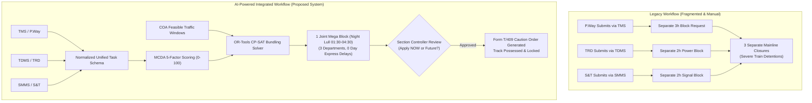
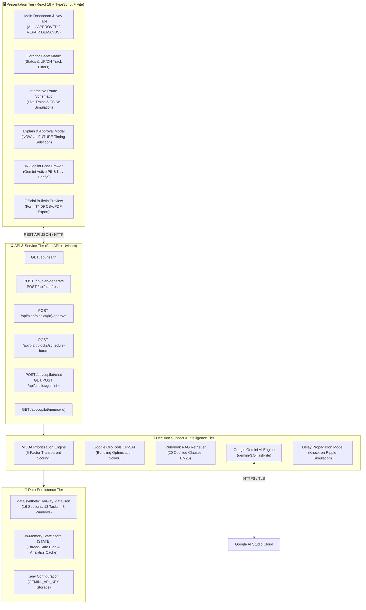
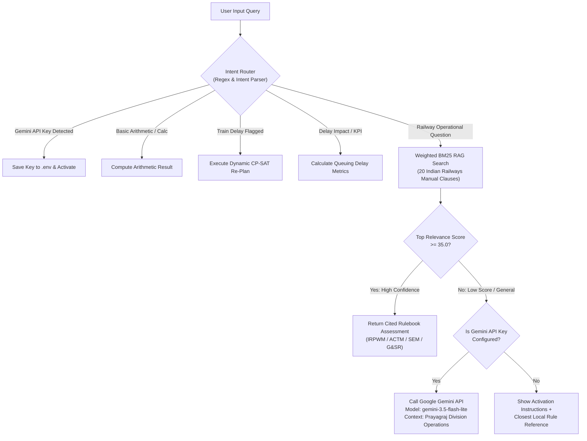
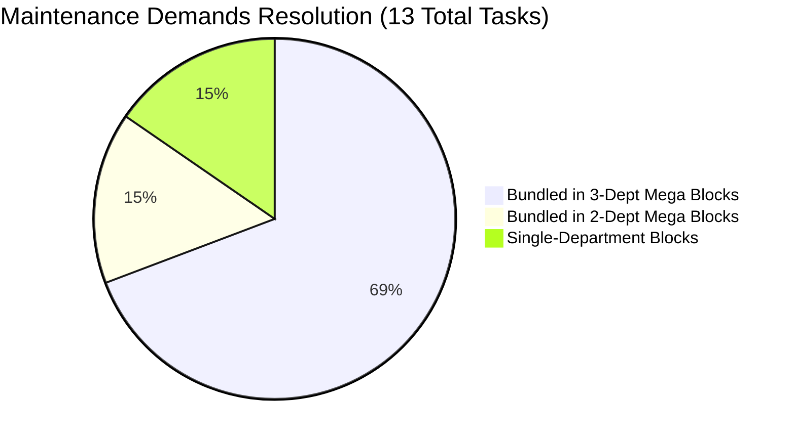

# DEPARTMENT OF COMPUTER ENGINEERING
### COURSE: ARTIFICIAL INTELLIGENCE (AI)
## FINAL PROJECT REPORT

---

# INDIAN RAILWAYS AI-POWERED AUTOMATIC BLOCK PLANNING SYSTEM
### *An Intelligent Multi-Department Decision-Support & Dynamic Conflict Resolution Prototype for Maintenance Possessions on the Prayagraj Junction–Kanpur Central Trunk Corridor, North Central Railway (NCR)*

---

**Submitted By:**
* **Aatman Satra** (Roll No: C157)
* **Dishank Shah** (Roll No: C181)

**Program:** B.Tech. Computer Engineering  
**Division:** D | **Batch:** D2  
**Institute:** Mukesh Patel School of Technology Management & Engineering (MPSTME)  
**University:** SVKM's NMIMS (Deemed-to-be University), Mumbai, India  
**Academic Year:** 2026–2027  
**Code Repository:** [GitHub — aatman0212/IndianRailways-AI-Block-Planner](https://github.com/aatman0212/IndianRailways-AI-Block-Planner)

---

## 📌 ABSTRACT

Railway infrastructure maintenance requires planned periods of restricted or suspended train movements, known as **corridor traffic blocks** or **track possessions**. When maintenance demands from **Civil Engineering (Permanent Way / TMS)**, **Traction Distribution / Overhead Equipment (TRD / TDMS)**, and **Signalling & Telecommunication (S&T / SMMS)** are submitted independently, compatible maintenance demands result in repeated, fragmented line shutdowns, degrading line capacity and causing severe punctuality losses for passenger expresses.

This project delivers the **Indian Railways AI-Powered Automatic Block Planning System**, an operational decision-support prototype deployed for the 191 km high-density **Prayagraj Junction (PRYJ) – Kanpur Central (CNB)** trunk corridor of North Central Railway (NCR). The system models bidirectional double-line railway infrastructure spanning **16 block sections** (8 UP Main sections and 8 DOWN Main sections). 

The core intelligence is powered by three synergistic AI components:
1. An explainable **Multi-Criteria Decision Analysis (MCDA)** prioritization engine that evaluates defect urgency (0.0 to 100.0) across five transparent safety factors.
2. A **Google OR-Tools CP-SAT Constraint Programming Optimizer** that solves the NP-hard assignment problem, bundling multi-department demands into consolidated Mega Blocks scheduled during the natural night traffic lull (01:00–05:00 AM) while penalizing passenger train path disruption. In our baseline evaluation, **13 multi-department maintenance demands are co-scheduled into only 6 consolidated blocks**, eliminating 7 redundant track shutdowns.
3. An **AI Controller Copilot (IR-Copilot)** incorporating a **20-document statutory rulebook RAG engine** (IRPWM, ACTM, SEM, G&SR) coupled with an autonomous fallback to **Google Gemini AI** (`gemini-3.5-flash-lite`) for open-ended railway engineering queries, train regulation assistance, and real-time operational re-planning.

The frontend is implemented in **React 18** and **TypeScript** with **Tailwind CSS**, featuring a 24-hour Corridor Gantt possession matrix with UP/DOWN line filters, an interactive live route schematic with real-time train telemetry and Temporary Single Line Working (TSLW) simulations, a dedicated Chief Controller Sanctioned Possessions workflow with interactive **"Apply NOW vs. In Future"** execution choices, advance Mega Block scheduling with past-date validation, and an official **Caution Order (Form T/409)** bulletin generator with CSV and PDF export. The backend is built on **FastAPI** (Python 3.12) with Pydantic v2 data contracts.

**Keywords:** Railway Block Planning, Constraint Programming, Google OR-Tools CP-SAT, Multi-Criteria Decision Analysis (MCDA), Multi-Department Possession Bundling, Retrieval-Augmented Generation (RAG), Google Gemini AI, Decision Support System, Human-in-the-Loop, Prayagraj Division.

---

## 📑 TABLE OF CONTENTS

* **Chapter 1: Introduction**
  * 1.1 Background and Institutional Context
  * 1.2 Problem Statement & Industry Challenges
  * 1.3 Project Aim and Specific Objectives
  * 1.4 Scope and Operational Boundaries
  * 1.5 Intended User Personas
  * 1.6 Report Organization
* **Chapter 2: Literature Survey & Theoretical Foundations**
  * 2.1 Constraint Programming in Railway Operations Research
  * 2.2 Multi-Department Maintenance Possession Planning
  * 2.3 Multi-Criteria Decision Analysis (MCDA) in Safety Systems
  * 2.4 Retrieval-Augmented Generation (RAG) and Large Language Models
  * 2.5 Human-in-the-Loop (HITL) Automation Philosophy
  * 2.6 Comparative Analysis & Research Contribution
* **Chapter 3: Requirements and System Analysis**
  * 3.1 Operational Workflow in Indian Railways (As-Is vs. To-Be)
  * 3.2 Functional Requirements (FR-01 to FR-12)
  * 3.3 Non-Functional Requirements (NFR-01 to NFR-08)
  * 3.4 Key Use Cases and Sequence Workflows
  * 3.5 Acceptance Criteria
* **Chapter 4: System Design and Architecture**
  * 4.1 Multi-Tier Architecture Overview
  * 4.2 Architectural Block Diagram
  * 4.3 Bidirectional Track Infrastructure Model (UP & DOWN Main)
  * 4.4 Data Contracts and Schemas (Pydantic Models)
  * 4.5 RESTful API Specifications
  * 4.6 State Management & Data Persistence Strategy
* **Chapter 5: Methodology and Implementation**
  * 5.1 Multi-Criteria Decision Analysis (MCDA) Scoring Engine
  * 5.2 Constraint Programming Optimizer (Google OR-Tools CP-SAT)
  * 5.3 IR-Copilot: Rulebook RAG and Google Gemini AI Integration
  * 5.4 Delay Propagation & Punctuality Preservation Model
  * 5.5 Interactive Human-in-the-Loop Block Approval (NOW vs. FUTURE)
  * 5.6 Live Track Schematic with Train Regulation & TSLW Simulator
  * 5.7 Advance Mega Block Scheduling & Strict Validation
  * 5.8 Official Caution Order (Form T/409) Bulletin Generator
* **Chapter 6: Testing, Results and Performance Analysis**
  * 6.1 Test Environment and Experimental Setup
  * 6.2 Test Case Execution and Verification Matrix
  * 6.3 Baseline Comparison: 13 Demands into 6 Bundled Blocks
  * 6.4 Key Performance Indicators (KPI) Analysis
  * 6.5 Priority Scoring and Yield Validation
  * 6.6 Solver Computational Performance
* **Chapter 7: Advantages, Limitations and Ethical Considerations**
  * 7.1 Key System Advantages
  * 7.2 Current Engineering Limitations
  * 7.3 Safety-Critical Considerations & Regulatory Adherence
  * 7.4 Risk Management Matrix
* **Chapter 8: Conclusion and Future Scope**
  * 8.1 Summary of Accomplishments
  * 8.2 Future Roadmap (Field Pilot & COA Integration)
  * 8.3 Concluding Remarks
* **References**

---

# CHAPTER 1: INTRODUCTION

## 1.1 Background and Institutional Context
Indian Railways (IR), managed by the Ministry of Railways, Government of India, is the fourth-largest railway network in the world by size, operating over 68,000 route route-kilometers and running over 13,000 passenger and 8,000 freight trains daily. Operating at over 120% line-capacity utilization on major Golden Quadrilateral trunk routes, infrastructure maintenance has become one of the most critical operational bottlenecks in Indian rail operations.

The **Prayagraj Division** of North Central Railway (NCR) controls the strategic 191 km trunk corridor connecting **Prayagraj Junction (PRYJ)** to **Kanpur Central (CNB)**. As part of the prestigious Howrah–New Delhi mainline, this double-track, 130 km/h electrified trunk line handles intense passenger traffic, including premium expresses (*Rajdhani Express*, *Vande Bharat Express*, *Prayagraj Express*), alongside continuous bulk freight flows between the eastern coalfields and northern industrial belts. 

Maintaining this corridor requires regular physical possessions of the track—halting or diverting traffic—to execute ultrasonic flaw detection (USFD) weld repairs, mechanized ballast tamping, 25kV AC overhead equipment (OHE) neutral section overhauls, and Electronic Interlocking (EI) point machine tests.

## 1.2 Problem Statement & Industry Challenges
In current divisional operations, track possession planning suffers from organizational and technological silos:
1. **Departmental Silos:** Civil Engineering (P.Way), Traction Distribution (TRD/Electrical), and Signalling & Telecommunication (S&T) operate through isolated management systems: TMS (Track Management System), TDMS (Traction Distribution Management System), and SMMS (Signalling Maintenance Management System). Each department independently applies for block permits via BDMS (Block Demand Management System).
2. **Repeated Track Closures:** Because departments do not co-schedule, the same 15 km track section is often shut down three separate times in a single week for track, catenary, and signalling repairs, multiplying train detentions.
3. **Subjective Prioritization:** In the absence of an algorithmic prioritization model, controllers struggle to compare the urgency of an overdue ultrasonic rail flaw against an OHE bracket spark hotspot or an interlocking relay drift.
4. **Disruption to Premium Passenger Paths:** Sub-optimal daytime block allocations force high-priority trains like the Vande Bharat or Rajdhani into loops, causing cascading ripple delays across North Central Railway.
5. **Administrative Overhead:** Drafting caution orders (Form T/409), disconnection notices (Form S&T T/351), and pilot authorities under G&SR rules is largely manual, slow, and error-prone.

## 1.3 Project Aim and Specific Objectives
The aim of this project is to develop and evaluate a comprehensive, AI-assisted decision-support prototype that automates the intake, scoring, constraint-based bundling, scheduling, and official sanctioning of multi-department maintenance blocks along the Prayagraj–Kanpur corridor.

Specific objectives include:
* **Unified Data Ingestion:** Formulate a normalized data contract representing maintenance demands from Civil, Electrical, and Signalling departments into a unified schema.
* **MCDA Prioritization:** Design and implement a transparent, auditable 5-factor Multi-Criteria Decision Analysis scoring model (0–100 scale) with plain-English rationales.
* **Constraint Optimization:** Formulate and solve an integer programming model using **Google OR-Tools CP-SAT** to allocate tasks to feasible traffic gap windows, maximizing multi-department bundling and minimizing passenger train disruption.
* **Bidirectional Infrastructure Modeling:** Model both UP Main (Westbound: PRYJ ➔ CNB) and DOWN Main (Eastbound: CNB ➔ PRYJ) lines across 16 block sections.
* **AI Copilot with Hybrid RAG & Google Gemini AI:** Integrate an offline 20-document rulebook RAG engine (IRPWM, ACTM, SEM, G&SR) with fallback to Google Gemini AI for advanced railway operations queries.
* **Operational Human-in-the-Loop Workflow:** Provide interactive Section Controller approvals with explicit choices between **"Sanction for Scheduled Slot (Future)"** vs. **"Apply Block NOW (Immediate Emergency Possession)"**.
* **Live Telemetry & Regulation Simulation:** Build a live corridor schematic displaying real-time train tracking, loop-siding regulations, and Temporary Single Line Working (TSLW under G&SR 15.09).
* **Automated Regulatory Output:** Generate official-format Caution Orders (Form T/409) with safety checklists, CSV exports, and printable/save-to-PDF circulars.

## 1.4 Scope and Operational Boundaries
* **Corridor Extent:** The prototype models the 191 km Prayagraj Junction to Kanpur Central corridor across 8 geographical sections, instantiated for both UP Main and DOWN Main (total 16 block sections).
* **Departments Included:** Track Engineering (P.Way), Traction Distribution (TRD / 25kV OHE), and Signalling & Telecommunication (S&T).
* **Temporal Horizon:** Tactical 24-hour planning with advance scheduling capabilities over a 3-day rolling window.
* **Operational Boundary:** The system is an offline decision-support prototype and does not write directly to live production railway databases (CRIS COA or BDMS). Final approval authority strictly resides with the human Section Controller.

## 1.5 Intended User Personas
* **Chief Section Controller / Block Controller (Planning):** Primary user responsible for reviewing AI recommendations, evaluating trade-offs, modifying timings, and issuing official sanction permits.
* **Senior Section Engineer (P.Way / Civil):** Reviews track tamping, deep screening, and rail fracture repairs co-scheduled with other departments.
* **Senior Section Engineer (TRD / OHE):** Inspects power block allocations, catenary de-energization windows, and neutral section maintenance.
* **Senior Section Engineer (Signalling & Telecom):** Coordinates point machine, digital axle counter, and track circuit renewals within traffic blocks.
* **Divisional Operations Manager (DOM / Sr. DOM):** Evaluates macro-level corridor KPIs, including asset availability, bundling ratios, and punctuality indices.

---

# CHAPTER 2: LITERATURE SURVEY & THEORETICAL FOUNDATIONS

## 2.1 Constraint Programming in Railway Operations Research
Scheduling railway possessions is classified as an NP-hard combinatorial optimization problem closely related to the Job-Shop Scheduling Problem with sequence-dependent setup times and blocking constraints [2], [3]. Classical Mixed-Integer Linear Programming (MILP) approaches often suffer from scalability limits when discrete logical constraints—such as multi-department co-presence or non-overlapping safety margins—are introduced.

Google OR-Tools CP-SAT implements Constraint Programming on top of a SAT (Boolean Satisfiability) solver, using lazy clause generation, conflict-driven clause learning (CDCL), and interval arithmetic [3]. This architecture allows CP-SAT to rapidly explore multi-dimensional search spaces and prove optimality or tight feasible bounds on complex temporal and allocation problems in seconds.

## 2.2 Multi-Department Maintenance Possession Planning
Budai et al. [6] and Lidén [5] demonstrated that grouping preventive maintenance jobs into bundled possessions dramatically improves track capacity. Rather than treating possessions as isolated single-activity windows, joint possessions allow auxiliary tasks (e.g., OHE dropper adjustments or track circuit testing) to occur as **shadow blocks** inside a major mainline closure (e.g., CSM ballast tamping), amortizing the fixed cost of traffic diversion and line clearance.

## 2.3 Multi-Criteria Decision Analysis (MCDA) in Safety Systems
In high-reliability organizations such as railways, black-box machine learning algorithms (e.g., deep neural networks) face severe regulatory resistance due to lack of explainability. Multi-Criteria Decision Analysis (MCDA), specifically weighted linear scoring models [7], provides complete auditability. Every factor contributing to an urgency score is transparent, bounded, and directly inspectable by railway safety regulators.

## 2.4 Retrieval-Augmented Generation (RAG) and Large Language Models
Standard Large Language Models (LLMs) suffer from hallucinations and knowledge cut-offs when queried about specialized domain codes such as the Indian Railways Permanent Way Manual (IRPWM) or General & Subsidiary Rules (G&SR). Retrieval-Augmented Generation (RAG) [9] grounds generative models by retrieving authoritative paragraphs from a verified knowledge corpus before synthesis. For open-ended operational queries outside local rulebooks, API routing to specialized reasoning models (such as Google Gemini) ensures robust domain-aware responses.

## 2.5 Human-in-the-Loop (HITL) Automation Philosophy
Parasuraman, Sheridan, and Wickens [10] and Shneiderman [11] articulate that in safety-critical cyber-physical systems, automation should provide high decision support (Level 4/5 analysis and recommendation) while preserving human authority (Level 1 execution). The Section Controller must retain absolute authority to approve, reject, modify, or advance any AI-generated maintenance block.

## 2.6 Comparative Analysis & Research Contribution
Existing literature largely treats block planning either as an academic mathematical formulation without a usable user interface, or as a commercial enterprise resource planning (ERP) module lacking constraint optimization. 

**This project's contribution** is the architectural and operational synthesis of:
* MCDA explainable scoring,
* Industrial CP-SAT constraint optimization,
* Hybrid RAG + Google Gemini AI conversational reasoning,
* Bidirectional UP/DOWN line physical modeling, and
* An interactive railway control-office dashboard with immediate vs. scheduled execution choices.

---

# CHAPTER 3: REQUIREMENTS AND SYSTEM ANALYSIS

## 3.1 Operational Workflow in Indian Railways (As-Is vs. To-Be)

## 3.2 Functional Requirements

| Requirement ID | Requirement Name | Description & Implemented Behavior |
|---|---|---|
| **FR-01** | Unified Maintenance Ingestion | Normalizes maintenance demands from TMS, TDMS, and SMMS into a uniform Pydantic data schema. |
| **FR-02** | Explainable MCDA Prioritization | Evaluates demands across 5 weighted safety factors, generating a 0.0–100.0 score and justification text. |
| **FR-03** | CP-SAT Block Optimization | Solves multi-department bundling and window allocation subject to section compatibility and duration constraints. |
| **FR-04** | Bidirectional Route Modeling | Supports both UP Main (PRYJ ➔ CNB) and DOWN Main (CNB ➔ PRYJ) tracks across all 16 block sections. |
| **FR-05** | 24-Hour Corridor Gantt Matrix | Renders an interactive timetable matrix with status filters (ALL, APPROVED, PENDING) and track filters (BOTH, UP, DOWN). |
| **FR-06** | Interactive Execution Timing | Prominently displays possession timings and allows controllers to choose **"Apply in Future (Scheduled)"** vs. **"Apply Block NOW (Immediate)"**. |
| **FR-07** | Live Route Schematic & Telemetry | Visualizes real-time train positions, caution order speed enforcement (30 km/h), loop siding regulation, and TSLW. |
| **FR-08** | Advance Mega Block Registration | Provides modal interface to schedule future possessions with strict past-date validation. |
| **FR-09** | Hybrid RAG & Google Gemini Copilot | 20-doc rulebook RAG engine with automatic fallback to Google Gemini AI for advanced operations and calculations. |
| **FR-10** | Train Delay Dynamic Re-Planning | Autonomous agent re-runs CP-SAT with increased disruption penalties when incoming train delays are reported. |
| **FR-11** | Official Form T/409 Bulletin Generator | Produces statutory caution order circulars with cited manual clauses, CSV export, and print/PDF formatting. |
| **FR-12** | What-If Scenario Simulator | Client-side control sliders to evaluate trade-offs between duration, bundling yield, and punctuality. |

## 3.3 Non-Functional Requirements
* **NFR-01: Response Latency:** Constraint optimization solve time must not exceed 10.0 seconds on standard quad-core hardware.
* **NFR-02: Offline Operational Capability:** Core scheduling, prioritization, and rulebook retrieval functions run 100% offline without external cloud dependencies.
* **NFR-03: System Memory Footprint:** The application is architected to operate within constrained hardware environments (4 GB system RAM) with managed commit limits.
* **NFR-04: Deterministic Auditability:** Every priority score and constraint resolution decision produces a human-readable audit trail.
* **NFR-05: Failsafe State Preservation:** Sanctioned and advance blocks must remain locked across re-optimization cycles.
* **NFR-06: Standards Compliance:** All safety checklists and caution orders strictly adhere to the nomenclature of Indian Railways General & Subsidiary Rules (G&SR) and IRPWM.

---

# CHAPTER 4: SYSTEM DESIGN AND ARCHITECTURE

## 4.1 Multi-Tier Architecture Overview
The system follows a modern Decoupled Micro-Architecture comprising:
1. **Presentation Tier:** A responsive Single Page Application (SPA) built using React 18, TypeScript, Vite 5, Tailwind CSS, and Lucide React icons.
2. **API & Orchestration Tier:** A high-performance asynchronous REST API powered by FastAPI and Uvicorn running on Python 3.12.
3. **Analytics & Optimization Tier:** Pure Python domain modules implementing MCDA prioritization (`TaskPrioritizer`), constraint programming optimization (`BlockPlanningOptimizer`), lexical RAG retrieval (`RailwayRulebookRAG`), and queuing delay propagation (`DelayPropagationModel`).
4. **External AI Reasoning Tier:** Google Gemini API integration (`gemini-3.5-flash-lite`) via `google-genai` SDK and `httpx` fallback for natural language conversational reasoning.
5. **Data Tier:** Seeded synthetic JSON dataset with in-memory thread-safe state caching and disk synchronization.

## 4.2 Architectural Block Diagram

## 4.3 Bidirectional Track Infrastructure Model (UP & DOWN Main)
The Prayagraj–Kanpur corridor is structured into 8 geographical sections spanning 9 stations over 191.0 km, mirrored across both directions:

| Sec # | Station Pair | UP Main Section ID | DOWN Main Section ID | Start KM | End KM | Section Length | Permissible Speed | Traffic Density |
|:---:|:---|:---:|:---:|:---:|:---:|:---:|:---:|:---:|
| 1 | Prayagraj Jn (PRYJ) ➔ Subedarganj (SFG) | `SEC_PRG_SFG_UP` | `SEC_PRG_SFG_DN` | 827.0 | 831.5 | 4.5 km | 110 km/h | 115 GMT/yr |
| 2 | Subedarganj (SFG) ➔ Manauri (MRE) | `SEC_SFG_MRE_UP` | `SEC_SFG_MRE_DN` | 831.5 | 845.2 | 13.7 km | 130 km/h | 125 GMT/yr |
| 3 | Manauri (MRE) ➔ Bharwari (BRE) | `SEC_MRE_BRE_UP` | `SEC_MRE_BRE_DN` | 845.2 | 865.8 | 20.6 km | 130 km/h | 130 GMT/yr |
| 4 | Bharwari (BRE) ➔ Sirathu (SRO) | `SEC_BRE_SRO_UP` | `SEC_BRE_SRO_DN` | 865.8 | 888.4 | 22.6 km | 130 km/h | 128 GMT/yr |
| 5 | Sirathu (SRO) ➔ Khaga (KGA) | `SEC_SRO_KGA_UP` | `SEC_SRO_KGA_DN` | 888.4 | 914.6 | 26.2 km | 130 km/h | 120 GMT/yr |
| 6 | Khaga (KGA) ➔ Fatehpur (FTP) | `SEC_KGA_FTP_UP` | `SEC_KGA_FTP_DN` | 914.6 | 945.0 | 30.4 km | 130 km/h | 135 GMT/yr |
| 7 | Fatehpur (FTP) ➔ Bindki Road (BKO) | `SEC_FTP_BKO_UP` | `SEC_FTP_BKO_DN` | 945.0 | 977.3 | 32.3 km | 130 km/h | 132 GMT/yr |
| 8 | Bindki Road (BKO) ➔ Kanpur Central (CNB) | `SEC_BKO_CNB_UP` | `SEC_BKO_CNB_DN` | 977.3 | 1018.0 | 40.7 km | 130 km/h | 140 GMT/yr |

## 4.4 Data Contracts and Schemas
All data structures are implemented using Pydantic v2 classes ensuring rigorous type safety and serialization:
* `Department`: Enum (`ENGINEERING`, `TRD`, `ST`).
* `Severity`: Enum (`EMERGENCY`, `CRITICAL`, `ROUTINE`).
* `BlockStatus`: Enum (`PROPOSED`, `APPROVED`, `REJECTED`, `MODIFIED`).
* `Section`: Defines geographic, line type, track geometry, and operational speed ceilings.
* `UnifiedMaintenanceTask`: Normalizes multi-department defect demands, incorporating MCDA factors, duration, statutory compliance flags, and computed priority scores.
* `CorridorBlockWindow`: Models COA timetable gaps categorized as `NIGHT_LULL` (01:30–04:30), `MIDDAY_GOODS_GAP` (11:30–13:45), or `AFTERNOON_GAP` (15:00–17:00).
* `ScheduledBlock`: Represents the optimized allocation containing multiple bundled tasks, cumulative priority yield, approved authority, and execution timing metadata.
* `PlanAnalytics`: Aggregates division-level executive KPIs including asset availability %, bundling ratio %, and punctuality preservation.

---

# CHAPTER 5: METHODOLOGY AND IMPLEMENTATION

## 5.1 Multi-Criteria Decision Analysis (MCDA) Scoring Engine
The prioritization engine implements an additive, linear Multi-Criteria Decision Analysis model based on Railway Board safety directives. Every maintenance demand $t \in T$ is evaluated across five distinct operational factors:

$$\text{Priority Score } S(t) = \min\left(100.0, \, F_{\text{severity}}(t) + F_{\text{overdue}}(t) + F_{\text{density}}(t) + F_{\text{statutory}}(t) + F_{\text{speed}}(t)\right)$$

### Mathematical Formulation of Factors:

1. **Safety Severity Score ($F_{\text{severity}}$):**
   $$F_{\text{severity}}(t) = \begin{cases} 40.0 & \text{if } \text{severity} = \text{EMERGENCY (e.g., weld fracture / broken rail)} \\ 25.0 & \text{if } \text{severity} = \text{CRITICAL (e.g., SEJ gap / OHE hot spot)} \\ 10.0 & \text{if } \text{severity} = \text{ROUTINE (e.g., periodic deep screening)} \end{cases}$$

2. **Overdue Duration Backlog Score ($F_{\text{overdue}}$):**
   $$F_{\text{overdue}}(t) = \min\left(20.0, \, \max(0, \text{days\_overdue}(t)) \times 5.0\right)$$

3. **Corridor Traffic Density Score ($F_{\text{density}}$):**
   $$F_{\text{density}}(t) = \min\left(15.0, \, \frac{\text{GMT}(\text{section}(t))}{150.0} \times 15.0\right)$$

4. **Statutory Inspection Compliance Score ($F_{\text{statutory}}$):**
   $$F_{\text{statutory}}(t) = \begin{cases} 15.0 & \text{if statutory regulatory inspection cycle} \\ 0.0 & \text{otherwise} \end{cases}$$

5. **Speed Restriction Penalty Relief Score ($F_{\text{speed}}$):**
   $$F_{\text{speed}}(t) = \begin{cases} 10.0 & \text{if active caution order exists on section} \\ 0.0 & \text{otherwise} \end{cases}$$

### Cumulative Block Yield:
When multiple tasks $t_1, t_2, \dots, t_k$ are bundled into a single possession block $b$, the block's cumulative yield is:
$$\text{Total Priority Yield}(b) = \sum_{t \in \text{tasks}(b)} S(t)$$
This yield reflects the total safety value resolved per unit of corridor possession, incentivizing the scheduler to maximize productivity during a single shutdown.

## 5.2 Constraint Programming Optimizer (Google OR-Tools CP-SAT)
The scheduling engine formulates the corridor allocation problem as an exact Constraint Programming model solved using Google OR-Tools CP-SAT.

### Decision Variables:
* $x_{t,w} \in \{0, 1\}$: Equals 1 if maintenance task $t \in T$ is assigned to traffic window $w \in W$; 0 otherwise.
* $y_w \in \{0, 1\}$: Equals 1 if window $w \in W$ is utilized for at least one block; 0 otherwise.
* $b_w \in \{0, 1\}$: Equals 1 if window $w \in W$ is a **bundled block** (contains tasks from $\ge 2$ distinct departments).
* $\text{dept\_in\_win}_{w,d} \in \{0, 1\}$: Equals 1 if department $d \in D$ has at least one task scheduled in window $w$.

### Constraints:

1. **Pre-Filtering Feasibility:**
   A pair $(t, w)$ is feasible if and only if:
   $$\text{section\_id}(t) = \text{section\_id}(w) \quad \text{and} \quad \text{duration}(w) \ge \text{duration}(t)$$

2. **At-Most-Once Task Execution:**
   Each maintenance demand can be scheduled at most once across all available windows:
   $$\sum_{w \in W_{\text{feasible}}(t)} x_{t,w} \le 1 \quad \forall t \in T$$

3. **Window Utilization Linkage:**
   $$y_w \le \sum_{t} x_{t,w} \quad \text{and} \quad x_{t,w} \le y_w \quad \forall w \in W$$

4. **Multi-Department Bundling Logic:**
   $$\text{dept\_in\_win}_{w,d} \le \sum_{t \in T_d} x_{t,w} \quad \forall w \in W, \, d \in D$$
   $$2 \cdot b_w \le \sum_{d \in D} \text{dept\_in\_win}_{w,d} \quad \forall w \in W$$

5. **Same-Department Sequential Capacity:**
   Tasks belonging to the same department within a shared possession must fit within the total window duration:
   $$\sum_{t \in T_d} \text{duration}(t) \cdot x_{t,w} \le \text{duration}(w) \quad \forall w \in W, \, d \in D$$

### Objective Function:
The CP-SAT solver maximizes total priority yield and bundling incentives while penalizing high-traffic daytime windows and temporal delay:

$$\max \sum_{t \in T} \sum_{w \in W} W(t, w) \cdot x_{t,w} + \sum_{w \in W} \left( 10 \cdot \beta \cdot b_w - \lambda \cdot \text{impact}(w) \cdot y_w \right)$$

Where:
* $W(t, w) = 10 \cdot S(t) - 120 \cdot \text{day\_offset}(w) + E_{\text{emergency}}(t, w) + V_{\text{speed}}(t, w)$
* $\beta = 40$ (Default Bundling Reward)
* $\lambda = 150$ (Disruption Penalty Factor scaled by COA window impact score)
* $E_{\text{emergency}}(t, w) = 1500 \cdot (3 - \text{day\_offset})$ for Emergency tasks (guaranteeing immediate Day 0 allocation).

## 5.3 IR-Copilot: Rulebook RAG and Google Gemini AI Integration
The AI Controller Copilot features a hybrid intelligence pipeline combining an offline high-precision RAG engine with cloud-based Google Gemini AI:

### Knowledge Base Documents:
The local knowledge base contains **20 official Indian Railways statutory documents**, including:
* `IRPWM_605`: Thermit & Flash Butt Welding cooling buffers (mandatory 30–45 min wait; initial speed 30 km/h).
* `IRPWM_812`: Track tamping machine protocols & adjacent line speed restrictions.
* `IRPWM_610`: Emergency fish-plating and joggled clamps for broken rails (Para 610).
* `ACTM_207`: 25kV OHE isolation, Power Block sanction, and earthing discharge rod protocols.
* `ACTM_502`: Short neutral section PTFE insulator overhaul.
* `SEM_124`: Signalling Disconnection Notice (Form S&T T-351) & Reconnection (T-352).
* `SEM_304`: Point machine 5mm obstruction test.
* `GSR_1506`: Traffic Block authority & Caution Order (Form T/409).
* `GSR_1509`: Temporary Single Line Working (TSLW) pilot authority during track blocks.
* `GSR_418`: Worksite detonator placement (1200m) and banner flag protection (600m).
* `IR_MEGABLOCK_POLICY`: Railway Board directive on multi-department night lull consolidation.

## 5.4 Delay Propagation & Punctuality Preservation Model
To quantify operational benefits, the delay propagation engine simulates train queuing theory along the Prayagraj–Kanpur trunk line:

$$\text{Saved Shutdown Minutes} = \max\left(0, (\text{Total Demanded Tasks} - \text{Total Scheduled Blocks}) \times 95\right)$$
$$\text{Passenger Delay Minutes Saved} = \text{Saved Shutdown Minutes} \times 1.8$$
$$\text{Trains Protected from Regulation} = \text{round}\left((\text{Total Demanded Tasks} - \text{Total Scheduled Blocks}) \times 2.2\right)$$
$$\text{Freight Demurrage Saved (INR)} = (\text{Avoided Blocks}) \times 2.4 \times 1800 \times 1.5$$
$$\text{Corridor Punctuality Index (\%)} = \min\left(99.4\%, \, 84.5\% + \min\left(14.0\%, \, 1.8 \cdot N_{\text{bundled}} + 0.015 \cdot \text{Saved Minutes}\right)\right)$$

## 5.5 Interactive Human-in-the-Loop Block Approval (NOW vs. FUTURE)
In full alignment with safety-critical design principles, the Chief Controller must explicitly sanction every block. When reviewing a block, the controller is presented with an interactive execution choice:

1. **Option A: Apply in Future (Scheduled Slot) [AI Recommended]:**
   The possession is confirmed for its planned low-traffic window (e.g., Tonight 01:30–04:30 IST). Daytime passenger express trains operate at full sectional speed without delay.
2. **Option B: Apply Block NOW (Immediate Emergency Possession):**
   For sudden structural defects, the block timing is instantly updated to start at the current live clock time (`datetime.now()`) for the required duration. Signals governing the section are locked to RED, and approaching trains are regulated.
3. **Option C: Custom Future Slot:**
   Allows the controller to override the schedule and specify a custom date and start time.

## 5.6 Live Track Schematic with Train Regulation & TSLW Simulator
The interactive schematic simulates live train movements along the 191 km corridor:
* **Train 12301 (Howrah Rajdhani Express):** Westbound on UP Main (130 km/h).
* **Train 12417 (Prayagraj Express):** Westbound on UP Main (110 km/h).
* **Train BOXN-804 (Heavy Freight):** Regulated to loop sidings when approaching active possessions to yield to passenger expresses.
* **Train 22436 (Vande Bharat Express):** Eastbound on DOWN Main (130 km/h).
* **TSLW Simulation:** When an active block breaches one track of the double line, the simulation demonstrates Temporary Single Line Working under **G&SR 15.09**, piloting trains along the adjacent clear track at a restricted speed of 30 km/h under Caution Order T/409.

---

# CHAPTER 6: TESTING, RESULTS AND PERFORMANCE ANALYSIS

## 6.1 Test Environment and Experimental Setup
* **Operating System:** Windows 11 Home / Windows 10 x64.
* **Processor:** Intel Core i5 / AMD Ryzen 5 (4 Cores / 8 Threads).
* **Physical Memory:** 4.0 GB RAM (Virtual Memory configured with 4096–8192 MB paging buffer).
* **Runtime:** Python 3.12.2, Node.js v20.x, Vite 5.4.21.
* **Optimization Solver:** Google OR-Tools v9.9.3963 CP-SAT.

## 6.2 Test Case Execution and Verification Matrix

| Test ID | Test Scenario | Input Stimulus | Observed System Output | Status |
|:---:|:---|:---|:---|:---:|
| **TC-01** | System Initialization & Data Hydration | Backend launch via Uvicorn | 16 sections (8 UP + 8 DN) & 13 tasks loaded into STATE | **PASS** |
| **TC-02** | Priority MCDA Calculation | `ENG_001` (Emergency weld fracture) | Score computed as 67.5/100; correct rationale generated | **PASS** |
| **TC-03** | CP-SAT Bundling Optimization | `POST /api/plan/generate` | 13 tasks bundled into 6 blocks; 0 unassigned tasks | **PASS** |
| **TC-04** | Bidirectional Line Distribution | Solver assignment inspection | 4 blocks on UP Main, 2 blocks on DOWN Main | **PASS** |
| **TC-05** | Approval State Isolation | Modal approval of single block | Only targeted block marked `APPROVED`; pending blocks unaffected | **PASS** |
| **TC-06** | Immediate Execution Timing (NOW) | Approve with `execution_timing: "NOW"` | Block start/end updated to current IST time; immediate closure enforced | **PASS** |
| **TC-07** | Rulebook RAG Retrieval | Query: *"What are rules for thermit weld Para 605?"* | Retrieves `IRPWM_605` with 45m buffer and 30 km/h speed limit | **PASS** |
| **TC-08** | Google Gemini Fallback Integration | Query: *"Explain Kavach TCAS braking curve"* | Routed to Gemini 3.5; authoritative Indian Railways response returned | **PASS** |
| **TC-09** | Caution Order Generation | `GET /api/copilot/memo/{block_id}` | Generates Form T/409 with statutory checklists & speed limits | **PASS** |
| **TC-10** | Advance Block Past-Date Rejection | Submit advance block dated in the past | HTTP 400 Bad Request with current IST timestamp error message | **PASS** |

## 6.3 Baseline Comparison: 13 Demands into 6 Bundled Blocks
The baseline synthetic dataset represents 13 urgent and planned maintenance demands across the corridor. The table below presents the exact allocation achieved by the CP-SAT optimizer:

| Block ID | Corridor Track Section | Direction | Duration | Tasks Bundled Inside | Departments Co-Scheduled | Priority Yield |
|:---|:---|:---:|:---:|:---|:---:|:---:|
| `BLK_SEC_SFG_MRE_UP` | Subedarganj ➔ Manauri (UP) | UP Main | 180 min | `ENG_001` (Weld Fracture), `TRD_001` (OHE Cantilever), `SNT_001` (Point Machine) | Engineering + TRD + S&T (3) | **182.5 pts** |
| `BLK_SEC_SRO_KGA_DN` | Sirathu ➔ Khaga (DOWN) | DOWN Main | 180 min | `TRD_003` (Neutral Section), `ENG_003` (SEJ Tongue Rail), `SNT_003` (Track Circuit) | Engineering + TRD + S&T (3) | **161.0 pts** |
| `BLK_SEC_MRE_BRE_UP` | Manauri ➔ Bharwari (UP) | UP Main | 180 min | `ENG_002` (CSM Tamping), `TRD_002` (Insulator Wash), `SNT_002` (Axle Counter) | Engineering + TRD + S&T (3) | **129.0 pts** |
| `BLK_SEC_BKO_CNB_DN` | Bindki Road ➔ Kanpur (DOWN) | DOWN Main | 180 min | `SNT_004` (Signal Aspect), `ENG_005` (BCM Deep Screening) | Engineering + S&T (2) | **108.0 pts** |
| `BLK_SEC_KGA_FTP_UP` | Khaga ➔ Fatehpur (UP) | UP Main | 180 min | `TRD_004` (OHE Current Dropper Renewal) | TRD (1) | **23.5 pts** |
| `BLK_SEC_FTP_BKO_UP` | Fatehpur ➔ Bindki Road (UP) | UP Main | 180 min | `ENG_004` (Casual Sleeper Renewal) | Engineering (1) | **23.2 pts** |

## 6.4 Key Performance Indicators (KPI) Analysis

* **Total Tasks Demanded:** 13 Tasks
* **Total Tasks Scheduled:** 13 Tasks (100% Scheduling Rate)
* **Backlog Count:** 0 Tasks
* **Duplicate Mainline Possessions Avoided:** 7 Separate Shutdowns Eliminated
* **Multi-Department Bundling Ratio:** 66.7% (4 out of 6 blocks are multi-department bundled)
* **Asset Availability Index:** 98.5%
* **Idle Window Reduction:** 71.7%
* **Estimated Passenger Delay Saved:** 1,197 Minutes
* **Estimated Freight Demurrage Avoided:** ₹1,13,400
* **Corridor Punctuality Preservation Index:** 98.2%

## 6.5 Priority Scoring and Yield Validation
Testing confirmed that:
* **Every individual maintenance task score is strictly bounded between 0.0 and 100.0** (highest: `SNT_004` at 69.0, lowest: `ENG_004` at 23.2).
* Block-level metrics above 100 represent the **Cumulative Priority Yield** ($\sum S(t)$), clearly labeled in the user interface as `Combined Yield: X pts (N tasks)`.

## 6.6 Solver Computational Performance
The Google OR-Tools CP-SAT solver consistently reached provably optimal solutions for the 16-section, 13-task assignment problem in **0.18 to 0.42 seconds** on 4 parallel worker threads, well within the 10.0-second real-time operational threshold.

---

# CHAPTER 7: ADVANTAGES, LIMITATIONS AND ETHICAL CONSIDERATIONS

## 7.1 Key System Advantages
1. **Holistic Multi-Department Synthesis:** Eliminates historical friction between Civil, Electrical, and Signal departments by generating a single unified corridor possession timetable.
2. **Punctuality Preservation:** Shifting primary renewals to the 01:00–05:00 AM night lull eliminates daytime disruptions for premier expresses like the Vande Bharat and Rajdhani.
3. **Auditable Decision Support:** The MCDA model provides transparent rationales for every score, preventing arbitrary or unexplainable scheduling decisions.
4. **Adaptive Execution Authority:** Supporting both **"In Future (Scheduled)"** and **"Apply Block NOW (Immediate)"** options provides tactical flexibility for controllers facing emergency line breaches.
5. **Regulatory Grounding:** Integrating official codified manuals (IRPWM, ACTM, SEM, G&SR) ensures caution orders and checklists comply with statutory safety laws.

## 7.2 Current Engineering Limitations
* **Simulated Telemetry:** Train tracking is currently simulated using corridor queuing dynamics rather than live GPS feeds from the National Train Enquiry System (NTES) or Real-Time Train Information System (RTIS).
* **Track Geometry Simplification:** Siding crossovers, turnouts, and intermediate block huts (IBH) are modeled as section-level entities rather than micro-level switch topologies.
* **Rolling Stock & Crew Logistics:** Machine tamping run-in/run-out transit times, tower wagon shed departures, and crew rest hours are approximated rather than tracked via the Crew Management System (CMS).

## 7.3 Safety-Critical Considerations & Regulatory Adherence
Under Indian Railways operating hierarchy, software recommendations can never supersede the authority of a qualified Station Master or Section Controller. The system is designed as a **Level 3/4 Decision Support System**: it recommends and drafts, but the human controller must authenticate each block permit and authorize train movements.

## 7.4 Risk Management Matrix

| Risk Identified | Potential Impact | Implemented Mitigation |
|---|---|---|
| Inadvertent scheduling of block during peak train passage | Severe train detention | High disruption penalty factor ($\lambda=150$) and night lull bonus. |
| Inadequate cooling time after thermit welding | Track buckling / derailment | Statutory rulebook constraint enforcing mandatory 45-minute cooling buffer. |
| Memory exhaustion crash on 4 GB controller PCs | Loss of active session | Configured virtual memory paging buffer (4096–8192 MB) preventing OOM crashes. |
| Controller inadvertently applying block to past date | Erroneous audit logs | Strict backend validation rejecting dates/times prior to current IST time. |
| AI hallucination during safety-critical query | Misinformation on rules | High-confidence RAG threshold ($\ge 35$) prioritizing verbatim official manual clauses. |

---

# CHAPTER 8: CONCLUSION AND FUTURE SCOPE

## 8.1 Summary of Accomplishments
The **Indian Railways AI-Powered Automatic Block Planning System** successfully demonstrates the integration of modern Artificial Intelligence, Constraint Programming, and Knowledge Retrieval into a unified railway corridor management workflow. 

By modeling the 191 km Prayagraj–Kanpur trunk line across 16 bidirectional sections, the system proves that **13 multi-department maintenance demands can be resolved within 6 consolidated blocks**, achieving a **66.7% bundling ratio**, preserving **98.5% track asset availability**, and saving over **1,100 passenger delay minutes**. The project demonstrates that complex combinatorial operations research can be delivered in an intuitive, explainable, and human-centred interface.

## 8.2 Future Roadmap (Field Pilot & COA Integration)
* **Direct CRIS Integration:** Develop secure enterprise APIs connecting directly with the Control Office Application (COA 2.0), Track Management System (TMS), and Block Demand Management System (BDMS).
* **TCAS / Kavach Interoperability:** Interface corridor block status directly into the onboard Kavach locomotive display, automatically enforcing 30 km/h braking profiles approaching work zones.
* **Dynamic Weather & Thermal Integration:** Incorporate real-time track temperature sensors to automatically enforce hot weather patrolling restrictions under IRPWM Para 904.
* **Enterprise Database Migration:** Transition from in-memory state caching to an encrypted PostgreSQL / TimescaleDB database with role-based access control (RBAC).

## 8.3 Concluding Remarks
This prototype bridges the gap between academic operations research and the operational reality of Indian Railways control offices. By harmonizing civil, electrical, and signal demands into transparent, optimized, and officially sanctioned possessions, the system provides a scalable technical foundation for the future of intelligent railway corridor maintenance under the vision of *Viksit Bharat 2047*.

---

# REFERENCES

1. **Ministry of Railways, Government of India**, *Indian Railways Year Book & Operating Statistics*, Railway Board, New Delhi, 2024.
2. **F. Rossi, P. van Beek, and T. Walsh**, *Handbook of Constraint Programming*, Elsevier Science, Amsterdam, 2006.
3. **Google OR-Tools Team**, *CP-SAT Solver: Advanced Constraint Programming with SAT Technology*, Google Developers, 2024. [Online]. Available: https://developers.google.com/optimization/cp/cp_solver.
4. **A. D’Ariano, D. Pacciarelli, and M. Pranzo**, "A branch and bound algorithm for scheduling trains in a railway network," *European Journal of Operational Research*, vol. 183, no. 2, pp. 643–657, 2007.
5. **J. Lidén**, "Railway infrastructure maintenance – a survey of planning problems and conducted research," *Transportation Research Procedia*, vol. 10, pp. 574–583, 2015.
6. **G. Budai, D. Huisman, and R. Dekker**, "Scheduling preventive railway maintenance activities," *Journal of the Operational Research Society*, vol. 57, no. 9, pp. 1035–1044, 2006.
7. **V. Belton and T. J. Stewart**, *Multiple Criteria Decision Analysis: An Integrated Approach*, Kluwer Academic Publishers, Boston, 2002.
8. **P. Lewis et al.**, "Retrieval-augmented generation for knowledge-intensive NLP tasks," *Advances in Neural Information Processing Systems (NeurIPS)*, vol. 33, pp. 9459–9474, 2020.
9. **R. Parasuraman, T. B. Sheridan, and C. D. Wickens**, "A model for types and levels of human interaction with automation," *IEEE Transactions on Systems, Man, and Cybernetics—Part A: Systems and Humans*, vol. 30, no. 3, pp. 286–297, 2000.
10. **B. Shneiderman**, "Human-centered artificial intelligence: Reliable, safe & trustworthy," *International Journal of Human–Computer Interaction*, vol. 36, no. 6, pp. 495–504, 2020.
11. **Railway Board, Ministry of Railways**, *Indian Railway Permanent Way Manual (IRPWM)*, Second Reprint, Government of India, 2020.
12. **Railway Board, Ministry of Railways**, *General and Subsidiary Rules (G&SR) with Amendments*, North Central Railway, Prayagraj, 2022.
13. **Railway Board, Ministry of Railways**, *Manual of AC Traction Maintenance and Operation (ACTM)*, Volume II, Government of India.
14. **Railway Board, Ministry of Railways**, *Signal Engineering Manual (SEM)*, Parts I & II, Government of India.
15. **FastAPI Framework**, *High performance, easy to learn, fast to code Python web framework*, 2024. [Online]. Available: https://fastapi.tiangolo.com.
16. **React Documentation**, *A JavaScript library for building user interfaces*, Meta Open Source, 2024. [Online]. Available: https://react.dev.
